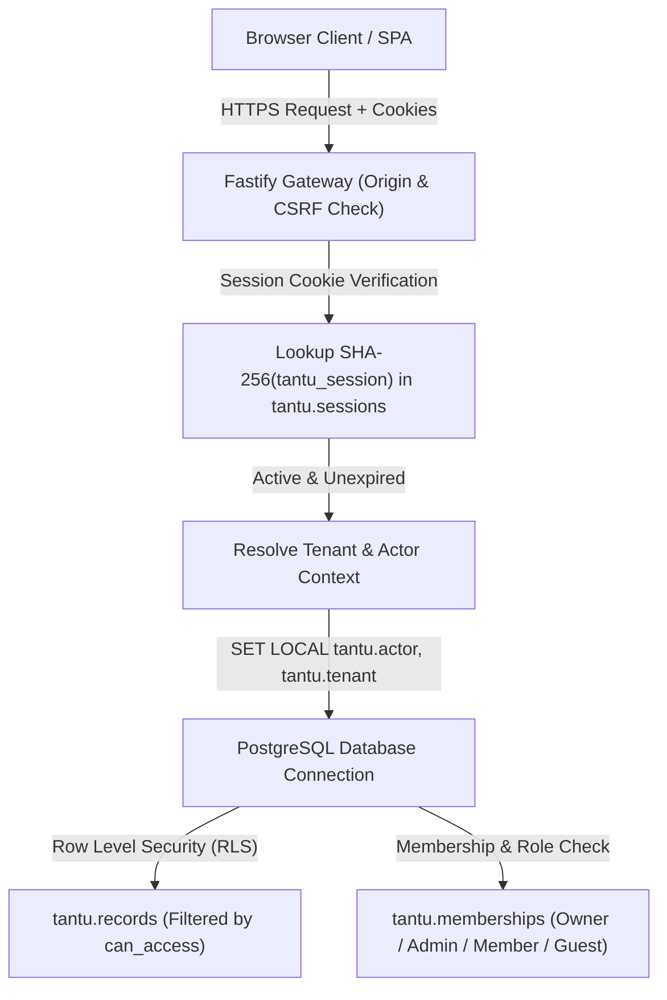
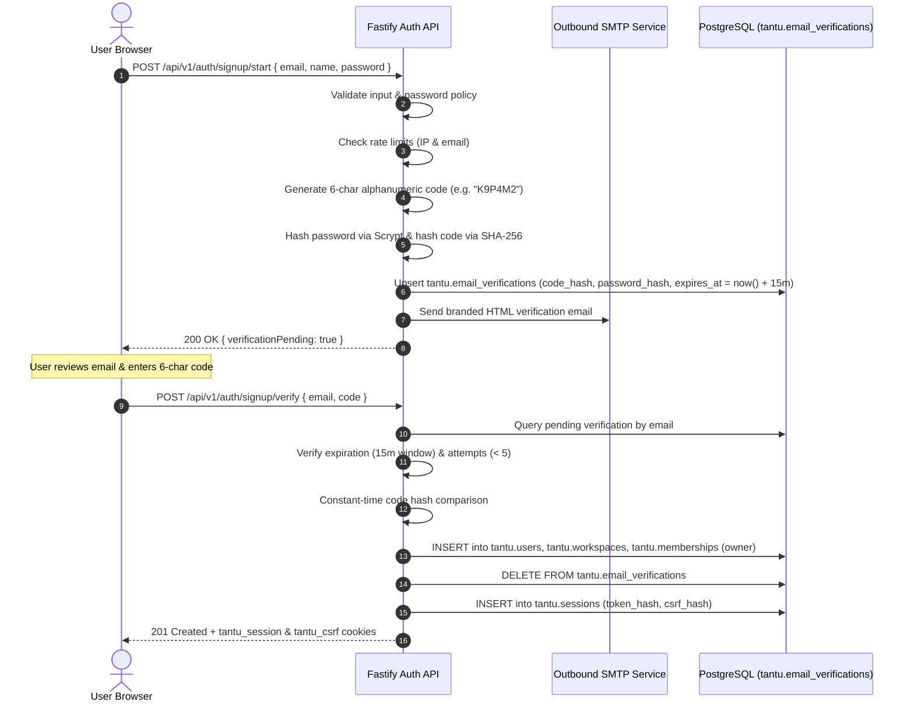

# Production Authentication & Authorization Specification

## 1. Executive Summary & Mission

This document details the production authentication, session management, credential lifecycle, and multi-tenant authorization architecture implemented in Tantu. The system follows the engineering standards outlined in the **Production Authentication and Authorization Skill** (`skills-agents-all/skills/authentication-authorization/SKILL.md`), adhering strictly to:

- **OWASP ASVS (Application Security Verification Standard)**
- **NIST SP 800-63B (Digital Identity Guidelines: Authentication and Lifecycle Management)**
- **RFC 9700 (OAuth 2.0 Security Best Current Practice)**
- **RFC 7636 (Proof Key for Code Exchange by OAuth Public Clients)**
- **Double-Submit Cookie CSRF Defense & Origin Matching**
- **Strict Multi-Tenant Row Level Security (RLS)** in PostgreSQL

---

## 2. Threat Model & Security Posture

| Threat Vector                                    | Mitigation Strategy in Tantu                                                                                                                                                                    |
| :----------------------------------------------- | :---------------------------------------------------------------------------------------------------------------------------------------------------------------------------------------------- |
| **Credential Stuffing & Brute Force**            | Dual-key sliding window rate limits on IP and email via `tantu.login_limits` (8 attempts/15 min per email, 60 attempts/15 min per IP), plus CPU-bound Scrypt backpressure.                      |
| **Signup Code Exhaustion & Brute Force**         | 6-character alphanumeric codes with SHA-256 storage, 15-minute expiration, and strict 5-attempt limit with automatic record eviction upon threshold violation.           |
| **Timing Attacks / User Enumeration**            | Constant-time password verification with synthetic fallback hash (`scrypt:00000000000000000000000000000000:...`) when user does not exist.                                                      |
| **Session Hijacking & XSS Theft**                | Session tokens stored strictly in `HttpOnly; SameSite=Lax; Secure` cookies, preventing client-side JavaScript access.                                                                           |
| **Cross-Site Request Forgery (CSRF)**            | Double-submit cookie pattern (`tantu_csrf` cookie + `x-csrf-token` header verified against session SHA-256 hash) combined with mandatory `Origin` header verification on all mutating requests. |
| **Session Fixation & Replay**                    | Immediate session rotation upon login, registration, and invitation acceptance. Database stores only SHA-256 hashes of tokens, never plaintext.                                                 |
| **Credential Rotation Stale Sessions**           | Changing password immediately revokes all _other_ active sessions for the user across all devices (`tantu.sessions.revoked_at = now()`).                                                        |
| **Insecure Direct Object Reference (IDOR/BOLA)** | Tenant isolation enforced in every database transaction via session-scoped PostgreSQL session variables `tantu.actor` and `tantu.tenant`, governed by PostgreSQL Row-Level Security policies.   |
| **Guest Privilege Escalation**                   | Guest users strictly confined to explicit record grants (`tantu.grants`) and disallowed from workspace-wide queries.                                                                            |
| **Token & Secret Exfiltration**                  | AES-256-GCM vault with authenticated associated data (AAD) for provider secrets, plus strict response sanitization.                                                                             |

---

## 3. Architecture Overview



---

## 4. Authentication Architecture

### 4.1 Server-Managed Sessions & Cookies

1. **Token Generation**:
   - Every session generates a 256-bit cryptographically secure pseudorandom token via `randomBytes(32).toString("base64url")`.
   - A companion CSRF token is independently generated with identical entropy.
2. **Server-Side Verifier Storage**:
   - The raw token is delivered to the browser inside the `tantu_session` cookie.
   - The database stores only `token_hash = sha256(raw_token)` in `tantu.sessions`. Even in the event of an unauthenticated database snapshot leak, no active session can be hijacked.
3. **Cookie Attributes**:
   - `tantu_session`: `Path=/; HttpOnly; SameSite=Lax; Max-Age=28800; Secure`
   - `tantu_csrf`: `Path=/; SameSite=Strict; Max-Age=28800; Secure`
4. **Session Expiry & Lifecycle**:
   - Absolute session validity is 8 hours (`now() + interval '8 hours'`).
   - Sessions are marked revoked immediately upon single logout (`revoked_at = now()`), global logout (`/auth/logout-all`), or password update.

### 4.2 Password Hashing & Verification

- **Algorithm**: Scrypt key derivation (`N = 32768`, `r = 8`, `p = 1`, `maxmem = 64MB`).
- **Salt**: 16-byte cryptographically secure random salt generated per password.
- **Constant-Time Verification**: Verification utilizes `crypto.timingSafeEqual` over 64-byte derived keys.
- **Password Policy**:
  - Minimum length: 12 characters.
  - Maximum length: 256 bytes (defends against CPU denial-of-service via massive input buffers).
  - Validation: Enforced on registration, password change, and invitation acceptance.
- **Concurrency Throttling**: Memory-intensive password derivation is bounded to 4 concurrent per-process derivations, failing with HTTP 429 (`AUTH_BUSY`) when overloaded.

### 4.3 CSRF & Origin Validation

For every state-changing HTTP request (`POST`, `PATCH`, `PUT`, `DELETE`):

1. **Origin Verification**:
   - `request.headers.origin` must strictly match the application's configured `APP_ORIGIN`. Mismatched or missing origins trigger HTTP 403 `ORIGIN_REJECTED`.
2. **Double-Submit Token Verification**:
   - The client passes the CSRF token in the `x-csrf-token` header.
   - The server computes `sha256(request.headers["x-csrf-token"])` and validates it against `session.csrfHash`. Mismatches trigger HTTP 403 `CSRF_REJECTED`.

### 4.4 Email Verification & Alphanumeric 6-Character Codes

To protect against disposable account creation, invalid email inputs, and unauthorized registration, registration uses verified two-step onboarding:



1. **Cryptographic 6-Character Alphanumeric Code**:
   - Alphabet: `ABCDEFGHJKLMNPQRSTUVWXYZ23456789` (32 characters, base-32).
   - Ambiguous characters omitted: `0` (zero) / `O` (letter O), and `1` (one) / `I` (letter I) are intentionally excluded to eliminate user transcription confusion across devices and fonts.
   - Entropy: Generated via `crypto.randomBytes(6)`, providing over 30 bits of cryptographic entropy.
2. **Zero Plaintext Storage**:
   - The database stores only `code_hash = sha256(code)`.
   - The user's intended password is pre-hashed using Scrypt before being held in `tantu.email_verifications`, ensuring no credentials ever exist in cleartext.
3. **Brute Force & Expiration Defense**:
   - The code expires in 15 minutes (`expires_at = now() + interval '15 minutes'`).
   - Failed attempts increment an atomic `attempts` counter.
   - Upon reaching 5 failed attempts (`attempts >= 5`), the verification entry is deleted immediately, requiring the user to restart the sign-up process.
4. **Resend Facility**:
   - `POST /api/v1/auth/signup/resend` issues a new code, refreshes the expiration window to 15 minutes, and resets the attempt counter.

### 4.5 Outbound SMTP & Email Delivery Engine

Tantu integrates a zero-dependency outbound mail subsystem directly in `backend/src/modules/mail/`:

1. **Direct Socket Transport (`backend/src/modules/mail/smtp.ts`)**:
   - Implemented using Node.js standard library `node:net` and `node:tls`.
   - Supports opportunistic STARTTLS (port 587) and direct TLS (port 465).
   - Authenticates via standard `AUTH LOGIN` with base64 credentials.
   - Enforces a 15-second command timeout with clean socket destruction on errors.
2. **Branded Email Templating (`backend/src/modules/mail/verification.ts`)**:
   - Generates dual MIME multipart alternatives (`text/plain` and `text/html`).
   - Plain text provides immediate terminal/client accessibility.
   - HTML provides responsive styling with prominent monospace code formatting, gradient header, and security advisory.
   - All dynamic input fields are strictly escaped against HTML injection.
3. **Offline & Test Safety**:
   - When running unit tests or offline environments (`NODE_ENV === "test"` or `--test` flag), outbound emails are routed to an in-memory `testOutbox` array, enabling fast and deterministic assertions without external network dependencies.

---

## 5. Multi-Tenant Authorization & Access Control

### 5.1 Role Hierarchy & Permissions

| Role       | Workspace Management | Member Invitation | Admin Invitation |  Role Modification  | Workspace-Wide Access | Scoped Record Grants |
| :--------- | :------------------: | :---------------: | :--------------: | :-----------------: | :-------------------: | :------------------: |
| **Owner**  |         Yes          |        Yes        |       Yes        | Yes (Can Transfer)  |          Yes          |         N/A          |
| **Admin**  |         Yes          |        Yes        |        No        | Members/Guests only |          Yes          |         N/A          |
| **Member** |          No          |        No         |        No        |         No          |          Yes          |         N/A          |
| **Guest**  |          No          |        No         |        No        |         No          |          No           |    Yes (Required)    |

### 5.2 Guest Record-Level Containment

Guests are external collaborators invited to participate in specific records (tasks or pages) without receiving visibility into the workspace as a whole.

- Inviting a guest without a valid `recordId` is rejected with HTTP 400 `RECORD_REQUIRED`.
- Record grants are persisted in `tantu.grants` with either `read` or `edit` permission.
- The PostgreSQL `tantu.can_access(record_id, editing)` recursive function validates whether the actor is the owner, a workspace member with workspace visibility, or an explicit grant recipient for the record or its ancestors.

### 5.3 PostgreSQL Row Level Security (RLS)

All tenant isolation is enforced at the database query layer:

```sql
ALTER TABLE tantu.records ENABLE ROW LEVEL SECURITY;
ALTER TABLE tantu.records FORCE ROW LEVEL SECURITY;

CREATE POLICY record_read ON tantu.records
  FOR SELECT USING(tantu.can_access(id));

CREATE POLICY record_insert ON tantu.records
  FOR INSERT WITH CHECK(
    workspace_id = tantu.tenant() AND
    owner_id = tantu.actor() AND
    tantu.member_role(workspace_id) IN ('owner','admin','member') AND
    (parent_id IS NULL OR tantu.can_access(parent_id, true))
  );

CREATE POLICY record_update ON tantu.records
  FOR UPDATE USING(tantu.can_access(id, true))
  WITH CHECK(
    workspace_id = tantu.tenant() AND
    (parent_id IS NULL OR tantu.can_access(parent_id, true))
  );
```

---

## 6. Complete Authentication API Reference

### 6.1 `POST /api/v1/auth/signup/start`

- **Description**: Initiates email verification by generating a random 6-character alphanumeric verification code, storing its SHA-256 hash and pre-hashed credentials, and dispatching a branded verification email via SMTP.
- **Headers**: `Origin: <APP_ORIGIN>`
- **Request Body**:
  ```json
  {
    "email": "user@example.com",
    "name": "Jane Doe",
    "password": "<user-supplied-password>"
  }
  ```
- **Response** (HTTP 200):
  ```json
  {
    "verificationPending": true,
    "email": "user@example.com"
  }
  ```

### 6.2 `POST /api/v1/auth/signup/verify`

- **Description**: Verifies the 6-character alphanumeric code, creates the user account, provisions the primary workspace with Owner role, establishes an authenticated session, and returns session cookies.
- **Headers**: `Origin: <APP_ORIGIN>`
- **Request Body**:
  ```json
  {
    "email": "user@example.com",
    "code": "K9P4M2"
  }
  ```
- **Response** (HTTP 201):
  ```json
  {
    "user": {
      "id": "7b0d91d8-4f8e-4a61-9c60-449e7fa69921",
      "email": "user@example.com",
      "name": "Jane Doe"
    },
    "workspaceId": "550e8400-e29b-41d4-a716-446655440000",
    "csrf": "<csrf-token>"
  }
  ```
- **Cookies Set**: `tantu_session`, `tantu_csrf`

### 6.3 `POST /api/v1/auth/signup/resend`

- **Description**: Generates a fresh 6-character verification code for an existing pending signup, resets expiration to 15 minutes, and resends the verification email.
- **Headers**: `Origin: <APP_ORIGIN>`
- **Request Body**:
  ```json
  {
    "email": "user@example.com"
  }
  ```
- **Response** (HTTP 200):
  ```json
  {
    "resent": true,
    "email": "user@example.com"
  }
  ```

### 6.4 `POST /api/v1/auth/register`

- **Description**: Creates a new user account, provisions their primary workspace, and issues an active authenticated session.
- **Headers**: `Origin: <APP_ORIGIN>`
- **Request Body**:
  ```json
  {
    "email": "user@example.com",
    "name": "Jane Doe",
    "password": "<user-supplied-password>"
  }
  ```
- **Response** (HTTP 201):
  ```json
  {
    "user": {
      "id": "7b0d91d8-4f8e-4a61-9c60-449e7fa69921",
      "email": "user@example.com",
      "name": "Jane Doe"
    },
    "workspaceId": "550e8400-e29b-41d4-a716-446655440000",
    "csrf": "<csrf-token>"
  }
  ```
- **Cookies Set**: `tantu_session`, `tantu_csrf`

### 6.2 `POST /api/v1/auth/login`

- **Description**: Authenticates an existing user and issues session cookies.
- **Headers**: `Origin: <APP_ORIGIN>`
- **Request Body**:
  ```json
  {
    "email": "user@example.com",
    "password": "<user-supplied-password>"
  }
  ```
- **Response** (HTTP 200):
  ```json
  {
    "csrf": "<csrf-token>"
  }
  ```

### 6.3 `GET /api/v1/auth/session`

- **Description**: Validates the current active session and returns user identity and active CSRF token.
- **Response** (HTTP 200):
  ```json
  {
    "user": {
      "id": "7b0d91d8-4f8e-4a61-9c60-449e7fa69921",
      "email": "user@example.com",
      "name": "Jane Doe"
    },
    "csrf": "<csrf-token>"
  }
  ```

### 6.5 `GET /api/v1/auth/session`

- **Description**: Validates the current active session and returns user identity and active CSRF token.
- **Response** (HTTP 200):
  ```json
  {
    "user": {
      "id": "7b0d91d8-4f8e-4a61-9c60-449e7fa69921",
      "email": "user@example.com",
      "name": "Jane Doe"
    },
    "csrf": "<csrf-token>"
  }
  ```

### 6.6 `GET /api/v1/auth/me`

- **Description**: Returns authenticated user profile information.
- **Response** (HTTP 200):
  ```json
  {
    "user": {
      "id": "7b0d91d8-4f8e-4a61-9c60-449e7fa69921",
      "email": "user@example.com",
      "name": "Jane Doe"
    }
  }
  ```

### 6.7 `GET /api/v1/auth/sessions`

- **Description**: Lists active sessions for the authenticated user, masking raw token digests and indicating the current device.
- **Response** (HTTP 200):
  ```json
  {
    "items": [
      {
        "id": "a1b2c3d4e5f67890",
        "createdAt": "2026-11-01T03:00:00.000Z",
        "expiresAt": "2026-11-01T11:00:00.000Z",
        "current": true
      },
      {
        "id": "f9e8d7c6b5a43210",
        "createdAt": "2026-10-31T20:00:00.000Z",
        "expiresAt": "2026-11-01T04:00:00.000Z",
        "current": false
      }
    ]
  }
  ```

### 6.8 `DELETE /api/v1/auth/sessions/:sessionId`

- **Description**: Revokes a specific active session. If revoking the current session, also clears authentication cookies.
- **Headers**: `x-csrf-token: <csrf>`, `Origin: <APP_ORIGIN>`
- **Response** (HTTP 200):
  ```json
  {
    "revoked": true
  }
  ```

### 6.9 `POST /api/v1/auth/change-password`

- **Description**: Updates user password, verifies current credentials, hashes new password via Scrypt, and revokes all other active sessions for that user.
- **Headers**: `x-csrf-token: <csrf>`, `Origin: <APP_ORIGIN>`
- **Request Body**:
  ```json
  {
    "currentPassword": "old-password-1234",
    "newPassword": "new-password-5678"
  }
  ```
- **Response** (HTTP 200):
  ```json
  {
    "updated": true
  }
  ```

### 6.10 `POST /api/v1/auth/logout`

- **Description**: Invalidates the current session in the database and clears cookies.
- **Headers**: `x-csrf-token: <csrf>`, `Origin: <APP_ORIGIN>`
- **Response** (HTTP 200):
  ```json
  {
    "signedOut": true
  }
  ```

### 6.11 `POST /api/v1/auth/logout-all`

- **Description**: Revokes all active sessions for the current user across all devices and clears cookies.
- **Headers**: `x-csrf-token: <csrf>`, `Origin: <APP_ORIGIN>`
- **Response** (HTTP 200):
  ```json
  {
    "signedOut": true,
    "revokedAll": true
  }
  ```

---

## 7. Frontend Integration & User Experience

1. **Sign-In & Verification Flow (`frontend/app/sign-in.tsx`)**:
   - 3-step state machine: `"signin"` | `"register"` | `"verify"`.
   - In `"register"` mode: user submits Name, Email, Password -> initiates `/auth/signup/start`.
   - In `"verify"` mode: displays formatted 6-character code input (auto-uppercase, monospace, letter-spaced), "Verify & Create Workspace" action, "Resend code" button, and "Change email" option.
   - Preserves invitation acceptance flow when an invite token is present in the URL (`?invite=...`) or pasted into the form.
2. **Workspace Settings Security Panel (`frontend/app/workspace-settings.tsx`)**:
   - **Active Sessions & Device Management**: Live list of active sessions with "This Device" badge for the current session, creation and expiration timestamps, individual "Revoke" buttons for remote sessions, and a "Log Out All Devices" action.
   - **Password & Credentials Form**: Current password verification, new password length validation, status banners, and automatic remote session invalidation upon password update.
   - **Enterprise Governance & DLP**: Automated redaction toggles, NDJSON audit log exports, and security architecture summaries.

---

## 8. Automated Test Matrix & Validation Results

The authentication and authorization implementation is validated by automated test suites spanning unit, domain, security, and full-stack integration:

| Test File                                   | Focus Area                                                                                                                                                                                                                                   | Tests |  Status  |
| :------------------------------------------ | :------------------------------------------------------------------------------------------------------------------------------------------------------------------------------------------------------------------------------------------- | :---: | :------: |
| `backend/test/auth-security.test.ts`        | Password policy, Scrypt salt uniqueness, constant-time verification, token entropy, session digest masking, role hierarchy, cookie parsing, double-submit CSRF, origin check, 6-character code generation, code normalizer, email formatting, SMTP test outbox |  13   | **PASS** |
| `backend/test/workspace-roles.test.ts`      | Role permission matrices (Owner, Admin, Member, Guest), invitation validation, hierarchy rules, ownership transfer                                                                                                                           |   4   | **PASS** |
| `backend/test/credentials.test.ts`          | Salted scrypt hashing, production runtime settings validation, concurrency backpressure limits                                                                                                                                               |   3   | **PASS** |
| `backend/test/integration/identity.test.ts` | Registration, session renewal, rate limits, session listing, remote revocation, password rotation, global logout                                                                                                                             |   3   | **PASS** |
| `discovery/test/security.unit.test.ts`      | Mailbox privacy, tombstone containment, guest record grants, snapshot scoping, timed-out review safety                                                                                                                                       |   5   | **PASS** |
| `frontend/test/routes.test.mts`             | URL prefixing, origin replacement prevention, shared route registry                                                                                                                                                                          |   3   | **PASS** |

### Authoritative Verification Summary

- **Linting (`npm run lint`)**: 100% PASS (Zero ESLint warnings or errors across frontend, backend, discovery).
- **Type Checking (`npm run typecheck`)**: 100% PASS (Next.js route types generated, TypeScript strict typecheck passed).
- **Test Suite (`npm run test`)**: 100% PASS (All 114 tests passed across all packages).
- **Production Builds (`npm run build`)**: 100% PASS (Next.js 16.4.3 static prerendering of 25/25 pages passed, backend TypeScript build passed).
